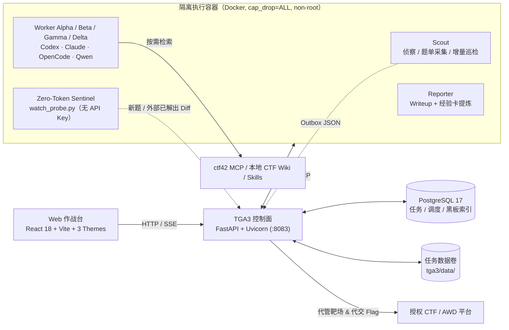

# TGA · Team Gipsy Agent

> 面向 CTF / AWD 与授权安全评测的 **黑板优先（Blackboard-First）多智能体协同作战平台**。

[](https://github.com/lyk2942712732-rgb/TGA-TeamGipsyAgent/tree/codex/scout-two-stage)
[](tga3/pyproject.toml)
[](apps/web/package.json)
[](tga3/docker/TOOL-BASELINE.md)

**TGA（TGA3）** 将 `Scout`（侦察 / 题单采集）、四位战术代号求解体（`Worker Alpha` / `Worker Beta` / `Worker Gamma` / `Worker Delta`）与 `Reporter`（报告与经验卡提炼）编排在同一套宿主控制面下：每个 Agent 在隔离的 Docker 容器中运行原生编码 CLI（**Codex CLI** / **Claude Code CLI** / **OpenCode CLI** / **Qwen Code CLI**），通过 **PostgreSQL + 证据化共享黑板** 实时同步事实与脚本，实现从自动收题、并行攻坚、动态靶场管理、代交 Flag 到持续候题与逐题 Writeup 的全链路闭环。

> **分支说明**
> - **`codex/scout-two-stage`**（本分支，日常主版本）：Linux 宿主机运行控制服务、Nginx 与 PostgreSQL，动态拉起隔离执行容器。
> - **[`codex/tsecbench-hosted`](https://github.com/lyk2942712732-rgb/TGA-TeamGipsyAgent/tree/codex/tsecbench-hosted)**：面向受限评测环境的托管分支，部署说明见该分支 README。

---

## 核心特性

- **槽位与 CLI 运行时解耦**：四个 Worker 采用战术代号（`Worker Alpha ~ Delta`），不再写死绑定特定厂商 CLI；可在配置中心或新建任务时，为每个槽位自由装配 `Codex CLI` / `Claude Code CLI` / `OpenCode CLI` / `Qwen Code CLI`，自动按协议兼容性筛选可用模型。
- **AOE 多题并行与四路战术调度**：
  - **边收集边解题**：Scout 收集期间，Worker 即可并行认领简单题或无难度题；
  - **全周期协同策略**：支持独立首轮尝试 → 换人接力 → 超过同难度均值自动求援增援 → 双人共同攻坚 → 仅剩最后 1 题触发四路围殴（`Swarm`），并支持运行中手动单题延长时间；
  - **宿主代管靶场与交 Flag**：支持远程附件按需懒下载、动态靶场配额调度与自动回收、宿主统一代交 Flag 与真实回执校验。
- **持续放题实战：零 Token 哨兵站岗 + 完题确认门控**：
  - 首轮收题结束后，若平台可脚本化并沉淀了 `/workspace/watch_probe.py`，系统默认进入 **零 Token 哨兵站岗**（每 45s 在无 API Key 的轻量容器内探测新题，几乎 0 开销）；无探测脚本时停在手动待命态，绝不擅自启动定时 LLM 轮询烧 Token；
  - 发现新题秒级自动唤醒 LLM Scout 增量入库并通知空闲 Worker 开干；发现平台已被外部/队友解出（`platform_solved`）自动结题、释放 Worker 与动态靶场，且不误记该 Worker 胜场；连续探测失败 3 次自动熔断告警；
  - 全部题目进入 `已解出 / 已放弃` 后，任务进入后端持久化 **完题确认门控**，前端弹出确认窗（可选择「继续任务，由 Scout 保持零 Token 哨兵站岗」或「立即结束任务」，刷新页面不丢失）。
- **证据优先的共享黑板与任务内经验卡**：
  - CLI 原生工具全量留痕，低摩擦 Finding 沉淀与交棒提醒；最终候选必须通过 Flag 与提交回执核验；
  - `Reporter` 为每道题独立产出 Markdown Writeup，并提炼可复用的局部解题经验卡（仅在同一 AOE 任务内跨题共享）。
- **双模式知识库与 9 类专项 Skills**：
  - 内置在线 **ctf42 MCP** 与本地离线 **CTF Wiki 索引**（`tga3 sync-knowledge`）两种知识源切换，配合按需网页搜索与 9 大安全方向 Skills（Web / Pwn / Reverse / Crypto / Misc / Forensics / Malware / OSINT / AI-ML）。
- **现代化 Web 作战工作台**：
  - 内置 `Obsidian`（默认暗色）/ `Daylight` / `Cyber` 三套主题切换，提供实时多智能体协作拓扑图、AOE 常驻 Scout 站岗控制条、按题隔离的黑板/Findings/事件/报告视图，以及任务原地断点重启与配置克隆。

---

## 系统架构



---

## 工作模式一览

### 1. AOE 多题并行模式（推荐用于整场 CTF / 持续放题赛）

1. **前置收集（`collection_only`）**：Scout 读取 `/task-overview/task.md` 与 `/inputs`，坚持证据驱动采集（绝不盲猜路径或自行开靶/交 Flag），将每道题原子写入 `/workspace/outbox/<source_key>.json`；对可脚本化平台同步生成只读探测脚本 `/workspace/watch_probe.py`。
2. **并行攻坚与动态调度**：
   - 首轮采集期间，Worker 优先认领简单题或无难度题；
   - 首轮结束后解锁全难度调度：独立首轮 → 换人接力 → 超时求援增援 → 双人共同攻坚 → 仅剩 1 题四路围殴；
   - 支持运行中对任意解题中题目手动延长本轮时间，支持单 Worker 暂停/恢复与运行中热切模型。
3. **持续放题站岗（`watching` / `standby`）**：
   - 首轮结束后，存在 `watch_probe.py` 默认开启 **零 Token 哨兵**（每 45s 探测）；无脚本则保持手动待命，可随时一键 **「唤醒 Scout 巡检」**、**「停止 Scout」** 或手动开启定时 LLM 巡检；
   - 增量扫描遇到老题自动幂等处理：新增官方 Hint 自动推入题目黑板；外部已解出自动结题并释放 Worker 改派下一题。
4. **完题确认与逐题报告**：
   - 每道题结束即独立触发 Reporter（`pre_solved` 与 `platform_solved` 自动跳过报告）；
   - 全部题目收尾后弹出确认窗，可选择继续站岗候题（保持默认零 Token 哨兵，不额外耗 Token）或归档结束任务。

### 2. 单题深度攻坚模式

内置 6 大专项场景（[scenes.json](tga3/config/scenes.json)）：`Web渗透测试`、`Pwn`、`Re逆向`、`Misc安全杂项`、`Crypto密码学问题`、`AI安全`。

1. **Scout 三阶段侦察**：在同一个容器与 CLI 会话中依次完成 `基础侦察（logs 留存）` → `逐 Action 提取原始 Intel` → `按覆盖率合并 Intel` 并导入共享黑板。
2. **四路 Worker 并行求解**：读取共享 Intel 与各自工作区，通过 Hook 实时同步黑板增量与 Findings，核验最终 Flag 后提交 `final-candidate.json`。
3. **Reporter 收尾**：基于不可变黑板快照与只读证据生成最终 Markdown Writeup 与经验卡。

---

## 快速部署（Linux）

### 环境要求

| 组件 | 最低要求 | 说明 |
| --- | --- | --- |
| 操作系统 | Ubuntu 22.04 / 24.04（或其他通用 Linux） | 完整容器化运行需要 Linux Docker Engine |
| Python | 3.11+ | 宿主机控制面 `.venv` |
| Docker | Docker Engine + Compose v2 + Buildx | 动态创建隔离执行容器与 PostgreSQL |
| Node.js | 22 LTS + npm | 构建静态前端（或开发模式运行） |
| Nginx | 1.24+（生产推荐） | 托管前端 `dist` 并反向代理 `/api/v3/` |

> **资源提示**：四个 Worker 默认单容器上限 `2 CPU / 4 GiB`（可在 `runtime.json` 调整，如 8 GB 内存机器建议单容器设 `3072 MiB` 并配置 4 GB Swap）。镜像基于 `python:3.12-slim-bookworm` 构建，工具基线见 [TOOL-BASELINE.md](tga3/docker/TOOL-BASELINE.md)。

### 方式一：一键部署（推荐）

```bash
git clone --branch codex/scout-two-stage https://github.com/lyk2942712732-rgb/TGA-TeamGipsyAgent.git
cd TGA-TeamGipsyAgent

# 启动 PostgreSQL、构建基础镜像与 Codex/Claude 镜像、安装控制面并构建前端
python3 tga3/scripts/deploy.py
```

如需同时启用 OpenCode 与 Qwen Code 两种 CLI 运行时，追加构建其轻量镜像层（共享 `tga3-cli-base:local`，耗时很短）：

```bash
cd tga3
for worker in opencode qwen; do
  docker build --network=host \
    --build-arg CLI_BASE_IMAGE=tga3-cli-base:local \
    -f docker/Dockerfile.$worker -t tga3-worker-$worker:local .
done
```

启动控制服务：

```bash
cd tga3
.venv/bin/tga3 --config-dir config serve
```

### 方式二：分步手动部署

```bash
# 1. 启动单机 PostgreSQL（仅绑定 127.0.0.1:5433）
cd tga3
docker compose up -d --wait postgres

# 2. 构建基础镜像与 4 套 CLI Worker 镜像
bash scripts/build-images.sh
for worker in opencode qwen; do
  docker build --network=host \
    --build-arg CLI_BASE_IMAGE=tga3-cli-base:local \
    -f docker/Dockerfile.$worker -t tga3-worker-$worker:local .
done

# 3. 安装控制面（开发态可加 -e）
python3 -m venv .venv
.venv/bin/python -m pip install -e '.[control]'

# 4. 构建前端
cd ../apps/web
npm ci
npm run build
```

> **国内 / 云服务器镜像加速提示**
> - 构建 `Dockerfile.cli-base` 时可传入 `--build-arg NODE_DOWNLOAD_BASE=https://npmmirror.com/mirrors/node`；
> - 阿里云 ECS 内网构建时可将 `DEBIAN_MIRROR` 设为 `mirrors.cloud.aliyuncs.com`、`NODE_DOWNLOAD_BASE` 设为 `http://mirrors.cloud.aliyuncs.com/nodejs-release`，大幅提速。

### 生产长期运行与安全访问

- **systemd + Nginx**：参考 [tga3.service](tga3/deploy/tga3.service) 与 [nginx-tga3.conf](tga3/deploy/nginx-tga3.conf) 修改仓库路径与运行账户（需加入 `docker` 组并保持与容器 UID/GID 一致，**勿用 root 掩盖挂载权限**）。
- **只读部署验收**：
  ```bash
  python3 tga3/scripts/verify-deployment.py --source-dir .
  ```
- **安全访问建议（比赛机 / 防火墙受限环境）**：**切勿将无鉴权的控制面直接暴露到公网**。推荐让 Nginx 仅监听回环非常见端口（例如 `127.0.0.1:28419`），本地通过 SSH 端口转发安全访问：
  ```bash
  ssh -L 28419:127.0.0.1:28419 <user>@<server-ip>
  # 本地浏览器打开 http://127.0.0.1:28419
  ```
- **升级与备份**：
  - 备份数据库：`docker exec tga3-postgres pg_dump -U tga3 tga3 > tga3-backup.sql`，同时备份 `tga3/config/`（含密钥，切勿上传公开仓库）与 `tga3/data/`；
  - 更新代码后，若改动了 `tga3/src/tga3/workers/`，需重新执行 4 个 Worker 镜像的 `docker build`（命中层缓存仅需十余秒），再 `systemctl restart tga3`；切勿使用 `docker compose down -v`。

---

## 配置、知识库与数据目录

### 核心配置文件（`tga3/config/`）

| 文件 | 作用 |
| --- | --- |
| `models.json` | 模型供应商、多协议端点（`openai_responses` / `openai_chat_completions` / `anthropic`）、模型启停与 API Key |
| `agents.json` | `Scout` / `Worker Alpha ~ Delta` / `Reporter` 槽位定义、默认装配的 CLI 运行时、模型与系统提示词 |
| `scenes.json` | 6 大单题场景与 `AOE多题` 场景的系统提示词 |
| `runtime.json` | 监听地址、PostgreSQL DSN、Docker 资源限额、容器回连宿主 WS/MCP 地址与超时预算 |
| `skills/` | 9 类专项 CTF Skills，按需以只读卷 `/skills` 挂载进容器（清单见 [skills/README.md](tga3/config/skills/README.md)） |

> 首次启动后打开 Web 页面进入 **模型配置** 与 **智能体配置** 即可可视化完成全部配置；控制面健康检查接口为 `GET /api/v3/health`。

### 本地离线 CTF Wiki 知识库

```bash
# 下载并构建本地 CTF Wiki Markdown 检索索引（供任务选择「本地知识库」模式时通过 MCP 检索）
cd tga3
.venv/bin/tga3 --config-dir config sync-knowledge
# 后续增量更新
.venv/bin/tga3 --config-dir config sync-knowledge --update
```

如需在浏览器中本地离线查阅 CTF Wiki 文档站，可另起静态容器：

```bash
docker run -d --name tga-ctf-wiki -p 127.0.0.1:4100:80 ctfwiki/ctf-wiki
# 访问 http://127.0.0.1:4100/
```

### 运行时数据布局（`tga3/data/`，不提交 Git）

```text
tga3/data/
├── tasks/<task_id>/
│   ├── inputs/                          # 用户上传原始材料（仅 Scout 读取）
│   ├── overview/{scene.md,task.md}      # 任务共享场景与初始指令
│   ├── collection-state.json            # Scout 采集与增量轮次状态信号
│   ├── workspaces/scout/                # Scout 工作区（outbox/imported/rejected/watch_probe.py）
│   └── <question_id>/                   # AOE 单题隔离目录（普通单题直接在任务根目录）
│       ├── question.json                # 题目视图与契约快照
│       ├── source.json                  # 平台原始题目记录
│       ├── inputs/                      # 单题附件（含按需懒下载远程附件）
│       ├── workspaces/<agent>/result/   # Agent 脚本与输出产物
│       ├── logs/<agent>/                # 完整 Action 审计日志
│       ├── findings/<agent>/            # 结构化 Finding 发布文件
│       ├── intels/scout/{raw,merged}/   # 普通单题三轮侦察 Intel
│       ├── final-candidate.json         # 经核验的最终候选与 Flag
│       └── writeups/                    # Reporter 生成的 Markdown Writeup
└── experience/{cards,assets}/           # 任务内可复用经验卡存储
```

---

## 开发与测试

```bash
# 后端依赖、测试与代码检查
cd tga3
python -m pip install -e '.[dev,control]'
pytest
ruff check src tests

# 前端开发服务（默认 http://127.0.0.1:5173，代理后端 :8083）
cd ../apps/web
npm ci
npm run dev

# 前端单测与生产构建
npm test
npm run build
```

---

## 仓库导览与深入文档

| 路径 | 内容 |
| --- | --- |
| [`apps/web/`](apps/web/) | React 18 + TypeScript + Vite 前端工作台与单测/E2E |
| [`tga3/src/tga3/`](tga3/src/tga3/) | FastAPI 控制面、AOE 调度与哨兵站岗引擎、Docker 运行时、CLI 适配器与 MCP 服务 |
| [`tga3/docker/`](tga3/docker/) | Slim 安全工具基础镜像、Node CLI 基础镜像与 4 种 Worker Dockerfile |
| [`tga3/scripts/`](tga3/scripts/) | 统一部署脚本 `deploy.py`、镜像构建与只读验证工具 |
| [`tga3/deploy/`](tga3/deploy/) | `systemd` 与 `Nginx` 生产部署样例 |

**专题设计文档**：
[运行时架构说明](tga3/README.md) ·
[运行状态模型](tga3/RUNTIME-STATE.md) ·
[AOE 数据流](tga3/docs/aoe-data-flow.md) ·
[四 Worker 调度规则](tga3/docs/four-workers.md) ·
[动态靶场管理](tga3/docs/aoe-targets.md) ·
[宿主 Flag 提交](tga3/docs/platform-submissions.md) ·
[文件发布与黑板协议](tga3/FILE-PUBLICATIONS.md) ·
[经验卡机制](tga3/EXPERIENCE.md) ·
[Worker 工具说明](tga3/WORKER-TOOLS.md) ·
[在线知识库 (ctf42)](tga3/docs/knowledge-ctf42.md) ·
[本地知识库 (CTF Wiki)](tga3/docs/knowledge-local.md)

---

## 合规声明与许可证

本项目仅限用于**获得明确授权的 CTF 竞赛、靶场训练、教学研究与安全评测**，严禁用于任何未经授权的网络渗透或破坏行为。使用与分发条款详见 [LICENSE](LICENSE)。
